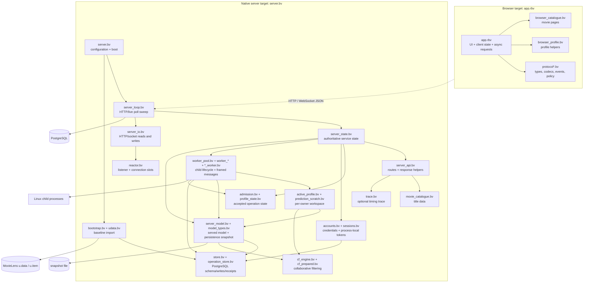
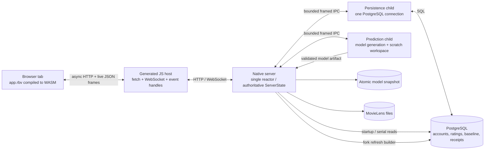
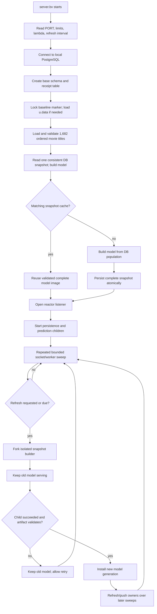

# Recommender system map

This guide gives four views of the current implementation: module structure,
runtime ownership, the rating-to-recommendation path, and model startup/refresh.
The source of truth is `examples/recommender/`; protocol and lifetime details
remain in the focused architecture notes alongside this file.

## 1. Components and dependencies

The arrows below mean “imports or directly uses.” The browser is a separate
compiled target. The native entry imports the server coordinator; most other
modules are shared only within their own target.



`cf_engine.bv` is the numerical reference implementation. It builds sparse
user/item rating populations, means, imputed values, Pearson similarities,
predictions and rankings. `active_profile.bv` reuses a worker-local workspace
for one account's prediction jobs; `server_model.bv` remains the serial served
path and owns snapshot loading/saving. The module names and current integration
are described in `recommender-server.md` and `recommender-active-profile.md`.

## 2. Runtime topology and ownership



The reactor owns socket slots, live-session ownership, session tokens, admitted
operations and the currently served state. It does not wait for a database save
or prediction on the interactive rating path: it sends bounded worker messages,
then polls for replies during later sweeps. There is one persistence child and
one prediction child in the current integration. Each worker channel allows one
outstanding request; busy admission is rejected for retry rather than silently
queued at the socket boundary. Refresh building is separate: a forked builder
produces a complete replacement snapshot while the old model continues serving.

## 3. Rating, save and recommendation data flow

```mermaid
sequenceDiagram
  autonumber
  actor User
  participant UI as Browser app
  participant S as Reactor / server state
  participant P as Persistence child
  participant DB as PostgreSQL
  participant W as Prediction child
  User->>UI: Select movie and rating
  UI->>UI: Create operation ID; paint rating pending
  alt WebSocket is open
    UI->>S: rating command + operation ID
  else no live channel
    UI->>S: HTTP fallback with same operation ID
  end
  S->>S: Authenticate token; validate and admit operation
  S-->>UI: accepted event / HTTP 202
  par Save
    S->>P: persist tagged operation
    P->>DB: account-locked upsert + durable receipt
    DB-->>P: committed receipt or failure/uncertain result
    P-->>S: saved / failed / uncertain event
    S-->>UI: save status event
  and Predict
    S->>W: profile revision + ratings + model generation
    W->>W: active-profile calculation and ranking
    W-->>S: tagged prediction result
    S->>S: Reject stale revision/generation result
    S-->>UI: recommendation event
  end
  UI->>UI: Apply prediction only for current profile revision
```

The UI has separate save and prediction state. A save confirmation changes the
operation status but does not trigger another recommendation render. If a
transport failure leaves the save outcome uncertain, the browser asks for
operation status; it does not blindly replay the write. The operation ID and
receipt make a confirmed retry idempotent. See `recommender-frontend.md`,
`recommender-accounts.md`, and `recommender-responsiveness-contract-v1.md`.

## 4. Startup and model refresh



Bootstrap and initial model construction happen before listening. During an
explicit or periodic refresh, the reactor keeps serving the installed model;
only a successfully completed and validated artifact replaces it. Model
identity includes the database/schema revision and epoch, so startup reuses a
cache only when it belongs to the same population. See `recommender-persistence.md`
and `recommender-server.md` for transaction, cache and failure guarantees.

## 5. A quick way to read the code

For a request path, start at `server.bv`, follow `server_loop.bv` into
`server_state.bv`, then inspect the route/helper module it calls. For a rating,
follow `server_dispatch_admission` and `server_worker_poll` in
`server_state.bv`, then the matching worker (`persistence_worker.bv` or
`prediction_worker.bv`). For recommendation math, start at `cf_engine.bv`; for
the reusable active-profile implementation, start at `active_profile.bv`.
For browser behavior, start at the `txn` handlers in `app.rbv` and follow the
`client_*` helpers they invoke.
